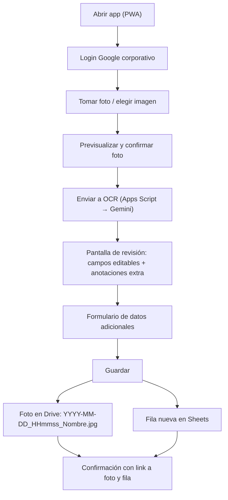
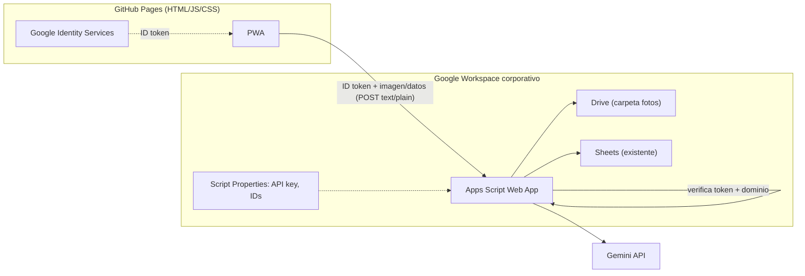

# SPEC — Presupuestalino (Captura de Recetas Ópticas)

> **Status: FINALIZED** (prototipo v0 — 2026-11-13)
> Preguntas abiertas resueltas con defaults configurables (§11). Revisar tras pruebas con recetas reales anonimizadas.

---

## 1. Objetivo

App web (PWA) que permite al personal de la óptica:
1. Fotografiar una receta óptica manuscrita.
2. Extraer automáticamente sus datos (OCR + interpretación).
3. Revisar y corregir lo extraído.
4. Completar datos adicionales.
5. Presupuestar cristales por medio par (`OD` / `OI`), armazón y medios de pago (Paso 4), con ficha imprimible/PDF e imagen para WhatsApp.
6. Guardar foto en Google Drive y datos en una fila nueva de un Google Sheets existente (más alta al catálogo si corresponde).

---

## 2. Contexto y restricciones

| Ítem | Valor |
|---|---|
| Usuarios fase inicial | ≤ 10 |
| Dispositivos | Corporativos (mobile + desktop), con cuenta Google Workspace corporativa |
| Hosting frontend | GitHub Pages (estático, HTTPS) |
| Backend | Google Apps Script Web App (sin servidores propios) |
| Datos en pruebas | No sensibles (recetas ficticias / anonimizadas) |
| Datos en producción | **Sensibles** (datos de salud — Ley 25.326, Argentina) |
| Costo objetivo | \$0 en pruebas; mínimo en producción |

---

## 3. Flujo de usuario

---

## 4. Requisitos funcionales

### FR-01 Acceso
- Login con Google Identity Services (GIS).
- Solo cuentas del dominio corporativo (claim `hd`).
- Email del usuario se registra en cada fila.

### FR-02 Captura
- `<input type="file" accept="image/*" capture="environment">`.
- Mobile: abre cámara trasera. Desktop: selector de archivo / webcam.
- Previsualización con opción "Repetir foto".
- Compresión en cliente: lado mayor máx. 2000 px, JPEG calidad ~0.85.

### FR-03 Reconocimiento (OCR + extracción)
- Imagen enviada a Apps Script → Gemini (multimodal) con **salida JSON estructurada** (schema fijo).
- Campos esperados de receta óptica:

| Grupo | Campos |
|---|---|
| Encabezado | Paciente, fecha receta, médico, matrícula |
| Lejos OD / OI | Esfera, cilindro, eje |
| Cerca OD / OI | Esfera, cilindro, eje (o Adición) |
| Otros | Adición, DIP (distancia interpupilar), prisma/base, tipo de lente, tratamientos |
| Libre | Observaciones legibles |

- **Anotaciones extra / garabatos**: todo texto o marca fuera de los campos estándar se devuelve en lista `anotaciones_extra[]`, cada una con transcripción tentativa y ubicación aproximada.
- Cada campo devuelve `confianza` (alta / media / baja).
- Se guarda también la respuesta cruda del OCR (auditoría).

### FR-04 Revisión y corrección
- Todos los campos extraídos son editables.
- Campos con confianza baja se resaltan visualmente.
- Imagen visible (con zoom) junto a los campos.
- Por cada anotación extra, el usuario decide: **Guardar como info extra** / **Descartar** / editar texto.
- Validaciones de formato (ej. esfera/cilindro en pasos de 0.25, eje 0–180).

### FR-05 Datos adicionales
- Formulario con campos definidos en §11-Q1.
- `Nombre` obligatorio (se usa para nombrar la foto).

### FR-06 Guardado
- Foto en carpeta Drive corporativa configurada.
  - Nombre: `YYYY-MM-DD_HHmmss_<Nombre-normalizado>.jpg` (sin tildes ni caracteres especiales; zona horaria `America/Argentina/Buenos_Aires`).
- Fila nueva (`appendRow`) en Sheet existente, columnas en §6.
- Respuesta al cliente: OK + link a la foto, o error descriptivo.
- Evitar duplicados: ID único por envío (`uuid`) — reintentos no generan filas duplicadas.

### FR-07 PWA
- `manifest.json` + service worker básico → instalable en home screen / escritorio.
- Sin modo offline en v1 (ver §9).

### FR-08 Presupuestador (Paso 4)
- Catálogo cargado desde pestaña `Catalogo` del Sheet (semilla automática si no existe) + modo **Carga manual** con opción de guardado al catálogo.
- Evaluación y selección independiente por **medio par (`OD` / `OI`)** con opción `Ambos ojos`, `Solo OD` o `Solo OI`, previa transposición automática a cilindro negativo.
- Bloqueo duro: no permite elegir productos `Stock` cuando la graduación del ojo exige `Laboratorio`.
- Validaciones inteligentes (asimetría de índice/tratamiento entre ojos, índice 1.50 en graduaciones altas o armazón ranurado/al aire, falta de DIP, coherencia de diseño vs Adición/Cerca).
- Armazón (sin armazón / propio / nuevo), Descuento/OS, Seña y medios de pago: Efectivo (`-10%`), Transferencia, Tarjeta (cuotas) y **Plan Cristalino** (cuotas, interés por mes y total financiado).
- Entrega doble: vista imprimible / PDF (`@media print`) e imagen PNG compartible/descargable para WhatsApp.

---

## 5. Arquitectura

### Endpoints Apps Script (un solo `doPost`, campo `action`)

| action | Entrada | Salida |
|---|---|---|
| `catalog` | idToken | Lista de cristales de pestaña `Catalogo` |
| `ocr` | idToken, imagen base64 | JSON estructurado (FR-03) |
| `save` | idToken, uuid, imagen base64, campos corregidos, extra, datos adicionales, presupuesto, nuevos ítems catálogo | `{ok, fotoUrl, fila}` |

### Seguridad
- Web App desplegada: *Ejecutar como: yo (cuenta de servicio/owner)*, *Acceso: cualquiera*.
- **Cada request** valida ID token de Google (firma/audiencia vía endpoint `tokeninfo`) y `hd == <dominio corporativo>`. Sin token válido → 401.
- API key Gemini, ID de Sheet e ID de carpeta solo en Script Properties. Nada secreto en el repo.
- POST con `Content-Type: text/plain` (evita preflight CORS no soportado por Apps Script).

---

## 6. Columnas del Sheet (propuesta)

| # | Columna |
|---|---|
| A | Timestamp |
| B | UUID |
| C | Usuario (email) |
| D | Nombre (form) |
| E… | Datos adicionales (§11-Q1) |
| … | Paciente, fecha receta, médico, matrícula |
| … | OD lejos esf/cil/eje, OI lejos esf/cil/eje |
| … | OD cerca, OI cerca / Adición |
| … | DIP, prisma, tipo lente, tratamientos |
| … | Observaciones |
| … | Anotaciones extra (aceptadas, separadas por `; `) |
| … | Link foto Drive |
| … | ¿Corregido por usuario? (Sí/No) |
| … | OCR crudo (JSON) |

> Si el Sheet existente ya tiene columnas, **se adaptan a las existentes** (§11-Q2).

---

## 7. Requisitos no funcionales

| ID | Requisito |
|---|---|
| NFR-01 | Responsive: usable en pantallas ≥ 360 px de ancho y en desktop |
| NFR-02 | OCR responde en ≤ 15 s (p95) |
| NFR-03 | Guardado en ≤ 10 s (p95) |
| NFR-04 | Navegadores: Chrome / Edge / Safari actuales |
| NFR-05 | Sin secretos en el repositorio público |
| NFR-06 | Errores visibles y comprensibles para el usuario; reintento sin duplicar |
| NFR-07 | Idioma de la UI: español (Argentina) |

---

## 8. Fases de datos y cumplimiento

| Fase | Datos | Motor OCR | Condición |
|---|---|---|---|
| Pruebas | Ficticios / anonimizados | Gemini API capa gratuita | Prohibido usar recetas reales (Google puede usar datos para entrenar) |
| Producción | Reales (salud) | Gemini **capa paga** o **Vertex AI** (sin uso para entrenamiento) | Revisar políticas internas, retención y permisos de Drive/Sheet |

- Drive y Sheet: compartidos solo con el grupo corporativo necesario.
- Revisar con responsable legal/IT antes de pasar a producción.

---

## 9. Fuera de alcance (v1)

- Modo offline / cola de envíos sin conexión.
- Edición o borrado de filas desde la app.
- Búsqueda / listado de recetas guardadas.
- Integración con otros sistemas.

---

## 10. Criterios de aceptación (verificables)

| # | Criterio | Prueba |
|---|---|---|
| AC-01 | Cuenta fuera del dominio no puede usar OCR ni guardar | Request con token ajeno → 401 (captura) |
| AC-02 | Foto desde mobile y desktop llega a la pantalla de revisión | Screenshots en ambos |
| AC-03 | ≥ 80 % de campos estándar correctos en set de 10 recetas de prueba | Tabla de resultados |
| AC-04 | Garabatos fuera de campos aparecen como anotaciones extra | Screenshot + JSON |
| AC-05 | Correcciones del usuario se reflejan en la fila | Screenshot del Sheet |
| AC-06 | Foto en Drive con nombre `YYYY-MM-DD_HHmmss_Nombre.jpg` | Screenshot Drive |
| AC-07 | Reintento del mismo envío no duplica fila | Screenshot Sheet |
| AC-08 | PWA instalable en Android/iOS/desktop | Screenshot |
| AC-09 | Ningún secreto en el repo | `git grep` de claves → sin resultados |

---

## 11. Decisiones por defecto (prototipo v0)

Preguntas abiertas resueltas con defaults **configurables**, sin tocar lógica:

| # | Pregunta | Default v0 | Dónde se cambia |
|---|---|---|---|
| Q1 | Campos del form adicional | Nombre cliente* (precargado desde paciente), Teléfono, Email cliente, ¿De dónde nos conoce? (Ya era cliente / Recomendación → Quién / Redes sociales → Cuál / Calle), Notas, Vendedor (desplegable: Gabriel, Micaela, Yamila) | `web/js/config.js` → `EXTRA_FIELDS` |
| Q2 | Columnas del Sheet existente | **Mapeo por encabezado**: el script lee la fila 1, escribe cada dato bajo su encabezado y agrega al final los encabezados faltantes. Sheet vacío → crea encabezados | Automático |
| Q3 | Dominio corporativo | Script Property `ALLOWED_DOMAIN` (+ opcional `ALLOWED_EMAILS`) | Script Properties |
| Q4 | Dueño de Script/Drive | La cuenta corporativa que despliega el Apps Script | `docs/SETUP.md` |
| Q5 | "Nombre" de la foto | Nombre del **cliente** (form) | `web/config.js` → `PHOTO_NAME_FIELD` |
| Q6 | Campos de receta | Schema genérico §4-FR-03. Ajustar con muestras reales | `apps-script/Code.gs` → `RX_SCHEMA` |
| Q7 | Repo / Pages | **Público** | — |

- **Modo demo** (`web/config.js` → `MOCK: true`): frontend funciona sin backend con datos simulados, para probar UI.

---

## 12. Alternativa registrada

Si la autenticación cross-origin (GitHub Pages ↔ Apps Script) da problemas, el frontend puede servirse desde el **propio Apps Script (HtmlService)** con acceso restringido al dominio. Pros: auth nativa. Contras: no usa GitHub Pages, URL menos amigable, UI dentro de iframe.

---

## 13. Anti-abuso (repo y página públicos)

Principio: **el código público no es el problema; los secretos y el endpoint sí.** Nada secreto vive en el repo. El endpoint rechaza todo request no autenticado.

| Capa | Medida | Frena |
|---|---|---|
| 1. OAuth consent "Interno" | Pantalla de consentimiento Workspace tipo *Internal* → solo cuentas del dominio pueden obtener token | Cuentas Gmail ajenas |
| 2. Validación de ID token | Backend verifica firma (`tokeninfo`), `aud` = Client ID, `exp`, `email_verified`, `hd` = dominio | Tokens falsos / de otra app |
| 3. Allowlist (opcional) | `ALLOWED_EMAILS` → solo los ~10 usuarios | Empleados no autorizados |
| 4. Pre-chequeo barato | Decodifica JWT localmente y rechaza (dominio/aud/exp/allowlist) **antes** de gastar UrlFetch | Agotar cuota con basura |
| 5. Caché de tokens válidos | `CacheService` por hash de token (≤ 10 min) | Llamadas repetidas a `tokeninfo` |
| 6. Rate limit por usuario | Máx. 30 OCR/h y 30 guardados/h por email (configurable) | Usuario legítimo comprometido / bug |
| 7. Freno global de fallos | > 200 rechazos/10 min → endpoint responde 429 sin procesar | Bombardeo anónimo |
| 8. Límites de payload | Imagen ≤ 4 MB, solo JPEG/PNG; textos con largo máximo | Payloads gigantes |
| 9. Auditoría | Cada fila guarda email + UUID + timestamp | Identificar y revocar |
| 10. Cuota Gemini | Límite/presupuesto en el proyecto de Google Cloud | Costos inesperados |
| 11. Sheet/Drive privados | Solo editables por dueño del script y grupo autorizado | Escritura directa |

Riesgo residual: un tercero puede **intentar** martillar la URL del Apps Script (consume cuota de ejecución gratuita), pero **no puede escribir datos** ni consumir Gemini.
